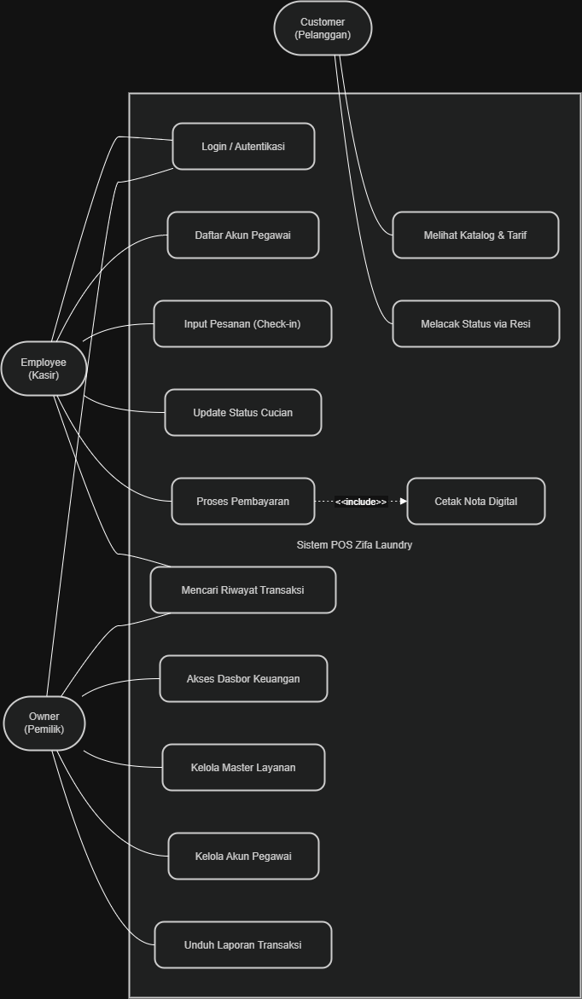
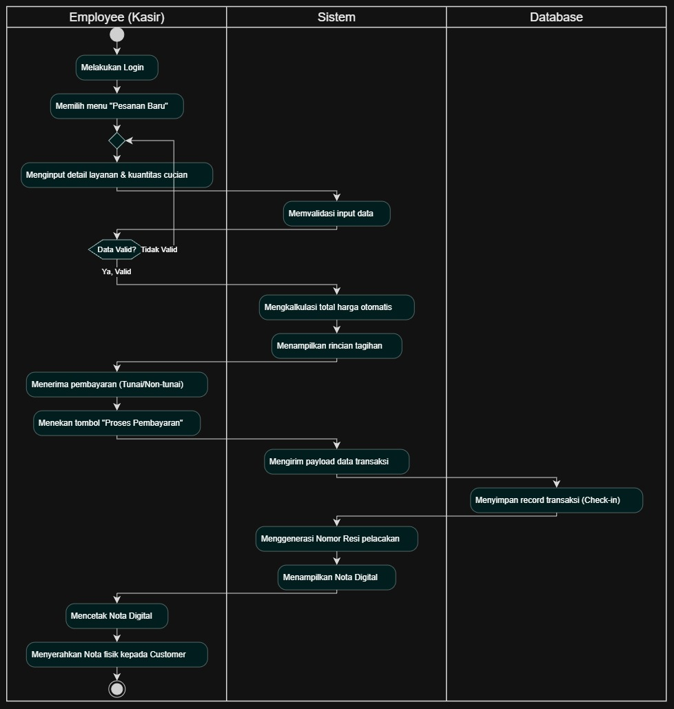
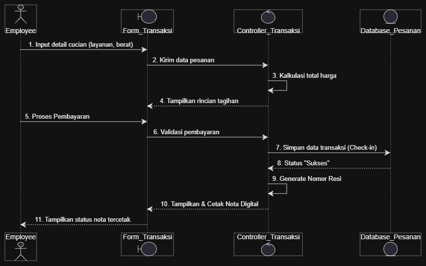
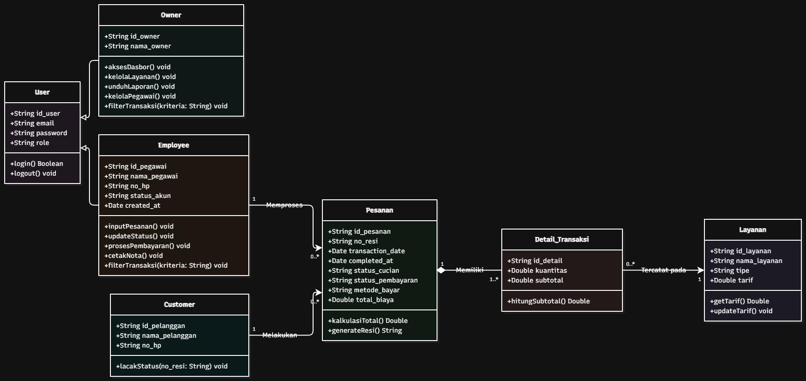
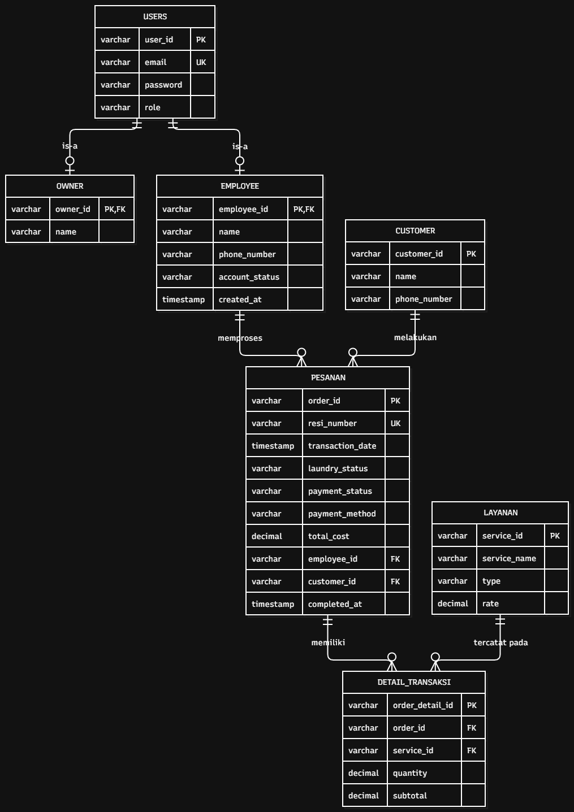

# Zifa Laundry Point of Sales (POS) & Management System

Sistem informasi kasir dan manajemen operasional laundry berbasis web (*Web-Based POS*). Aplikasi ini dirancang khusus untuk digitalisasi proses bisnis laundry, mulai dari manajemen transaksi harian, pelacakan progres cucian, manajemen akun staf, hingga pelaporan keuangan terintegrasi secara *real-time*.

## Arsitektur & Deployment Sistem

Proyek ini mengadopsi arsitektur terdistribusi (*Decoupled Architecture*), di mana sisi antarmuka (*frontend*) beroperasi secara mandiri dan berkomunikasi dengan peladen pemrosesan data (*backend* API) melalui HTTP requests.

* **Frontend (Antarmuka Pengguna):** Dihosting di **Vercel** sebagai situs statis berkecepatan tinggi, memanfaatkan konfigurasi `vercel.json` untuk pengalihan rute (*rewrites*) API.

* **Backend (API & Logika Bisnis):** Dihosting di **Render (Free Tier)** menggunakan *environment* Node.js / Express.

* **Database (Basis Data):** Menggunakan **Supabase (PostgreSQL)** sebagai pusat penyimpanan data awan yang aman.

### Diagram Arsitektur

```






```

## Tools & Teknologi Pengembangan

| Kategori | Teknologi / Alat | Fungsi Utama | 
| ----- | ----- | ----- | 
| **Backend Runtime** | Node.js & Express.js | Membangun RESTful API dan menangani logika sisi peladen. | 
| **Frontend UI/UX** | HTML5, CSS3, JavaScript Vanilla | Membangun antarmuka pengguna yang responsif (*Mobile-First*). | 
| **Database** | Supabase (PostgreSQL) | Menyimpan entitas transaksi, akun, layanan, dan laporan. | 
| **Manajemen Waktu** | Day.js | Manipulasi zona waktu, rentang harian, mingguan, dan bulanan. | 
| **Penyimpanan Cache** | Node-Cache | Menyimpan memori sementara di sisi server (RAM) untuk data berat. | 
| **Keamanan** | Express Rate Limit & CORS | Melindungi API dari serangan *brute-force* dan membatasi asal akses. | 
| **Version Control** | Git & GitHub | Manajemen kode sumber dengan sistem *branch* (`production`, `development`, `deployment`). | 
| **Cloud Hosting** | Vercel & Render | Penyedia layanan *deployment* antarmuka publik dan mesin API. | 

## Hak Akses & Tugas Role

Sistem ini memiliki manajemen kontrol akses berbasis peran (*Role-Based Access Control*) untuk menjaga privasi data:

### 1. Owner (Pemilik Usaha)

* **Dashboard Eksekutif:** Memantau ringkasan pendapatan keseluruhan, rata-rata transaksi, dan tren penjualan.

* **Laporan Keuangan:** Mengakses rekam jejak keuangan untuk periode Harian (Sesi Pagi, Siang, Sore, Malam), Mingguan, dan Bulanan.

* **Ekspor Data:** Mengunduh rekapitulasi data keuangan ke dalam format `CSV` untuk pembukuan eksternal.

* **Manajemen Pegawai:** Menyetujui (*Approve*) atau menolak akun staf (*Employee*) baru yang mendaftar.

* **Pengaturan Tarif (Katalog):** Mengelola daftar layanan cuci, jenis satuan (kg/tabung), dan penyesuaian harga jual.

* **Riwayat Transaksi:** Melacak pesanan berdasarkan tanggal, nama pelanggan, atau nomor resi unik.

### 2. Employee (Staf / Kasir)

* **Kasir (Pencatatan Pesanan):** Memasukkan data transaksi pelanggan, memilih layanan, dan menghitung total tagihan.

* **Manajemen Progres:** Memperbarui status cucian secara iteratif (*Dicuci* ➔ *Dikeringkan* ➔ *Disetrika* ➔ *Siap Ambil* ➔ *Selesai*).

* **Riwayat Transaksi:** Melacak pesanan berdasarkan tanggal, nama pelanggan, atau nomor resi unik.

### 3. Customer (Pelanggan Publik)

* **Pelacakan (Tracking):** Memasukkan nomor resi (contoh: `ZL-XXXXX`) pada halaman publik untuk memantau status pengerjaan pakaian mereka secara mandiri tanpa perlu menghubungi kasir.

* **Katalog Layanan:** Melihat harga dan daftar layanan apa saja yang disediakan oleh pihak Zifa Laundry.

## Alur Sistem (*System Workflow*)

1. **Autentikasi (Alur Masuk):**

   * Staf mendaftar akun melalui halaman Register.

   * *Owner* masuk ke sistem, meninjau pendaftaran, dan menyetujui akun tersebut.

   * Staf (*Employee*) yang disetujui baru dapat melakukan *login* ke sistem kasir.

2. **Alur Pemesanan:**

   * Pelanggan menyerahkan pakaian kotor ➔ Kasir menimbang/menghitung pakaian ➔ Kasir membuat pesanan baru di sistem.

   * Sistem otomatis membuat **Nomor Resi Unik** dan mencatat Waktu Masuk (WIB).

3. **Alur Pelaporan Harian (Berbasis Sesi):**

   * Setiap transaksi yang selesai akan otomatis dikelompokkan ke dalam empat sesi laporan harian berdasarkan jam transaksi (WIB):

     * **Pagi:** 08.00 - 11.59 WIB

     * **Siang:** 12.00 - 15.59 WIB

     * **Sore:** 16.00 - 19.59 WIB

     * **Malam:** 20.00 - 23.59 WIB

## Teknik Optimisasi Performa & Keamanan

Untuk menjaga kestabilan aplikasi, terutama di lingkungan peladen gratis (*Free Tier*), beberapa teknik optimisasi tingkat lanjut telah diimplementasikan:

1. **Server-Side Caching (`node-cache`):**
   Kueri laporan keuangan (yang melakukan kalkulasi rentang tanggal dan agregasi ribuan baris data) memakan banyak sumber daya database. Solusinya, hasil kalkulasi ini disimpan di dalam memori RAM server (`node-cache`) dengan masa kedaluwarsa (TTL) selama 5 menit. Jika *Owner* menyegarkan halaman berulang kali, data diambil dari memori internal (0 milidetik) tanpa membebani Supabase.

2. **Rate Limiting & Trust Proxy:**
   Karena peladen dijalankan di balik *proxy cloud* Render, Express sering gagal mendeteksi IP asli pengguna. Fitur `app.set('trust proxy', 1)` diaktifkan agar modul `express-rate-limit` dapat membaca *header* `X-Forwarded-For` dengan tepat. Hal ini mengamankan *endpoint* vital (seperti *login*) dari serangan *brute-force* atau *spam*.

3. **Manajemen Zona Waktu Presisi (`dayjs`):**
   Basis data Supabase menyimpan waktu secara universal (UTC). Tanpa konversi, transaksi jam 12 siang di Indonesia (WIB) akan tercatat sebagai jam 5 pagi (UTC), merusak agregasi sesi laporan harian. Dengan mengintegrasikan manipulasi `dayjs(date).add(7, 'hour')`, sistem secara dinamis mengonversi transaksi ke waktu lokal (WIB/UTC+7) sebelum melakukan klasifikasi sesi Pagi/Siang/Sore/Malam.

*Dikembangkan dengan penuh dedikasi dari Kelompok B (Univeristas Terbuka) untuk efisiensi operasional Zifa Laundry.*